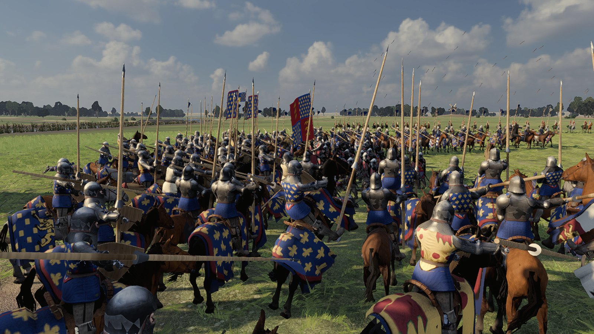
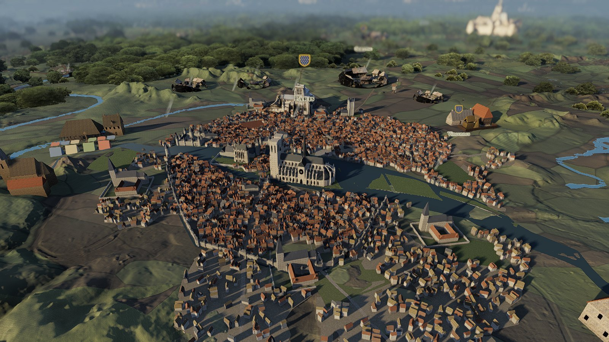
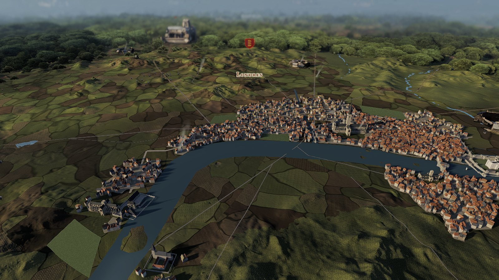
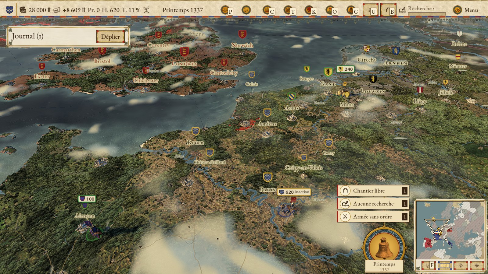
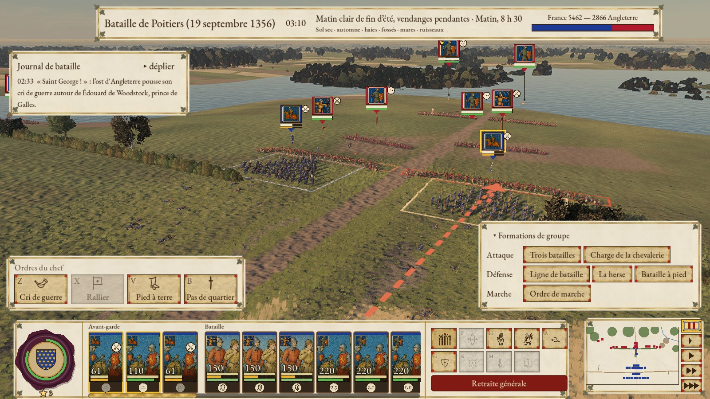
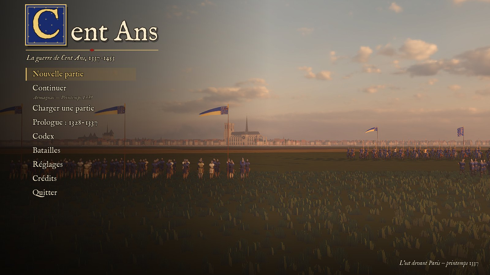

# Cent Ans

**Jeu de grande stratégie historique sur la guerre de Cent Ans (1337-1453)**, libre et open source.

Une carte de campagne au tour par saison sur l'Europe réelle, puis des batailles et des sièges en 3D en
temps réel avec pause, dans l'esprit de *Total War*. Incarnez la France des Valois, l'Angleterre des
Plantagenêts ou la Bourgogne, et menez un siècle de guerre, de diplomatie, de dynasties et de crises.

Architecture du dépôt : [`docs/architecture.md`](docs/architecture.md).



| Paris en 1337 sur la carte de campagne | Londres et la Tamise |
|---|---|
|  |  |

| Carte de campagne | Bataille de Poitiers (1356) |
|---|---|
|  |  |



*Captures en jeu (client Godot d'origine, retiré le 17/10/2026, ADR 0366).*

## Fonctionnalités

- **Carte réelle** de l'Europe occidentale : relief ETOPO/Copernicus, 132 provinces de 1337, fleuves,
  routes, forêts et zones humides de l'époque, déplacement libre des armées.
- **Campagne complète** de 1337 à 1453 (1477 pour la Bourgogne), 29 factions, objectifs historiques.
- **Batailles et sièges 3D** en temps réel avec pause : déploiement, formations, moral, des milliers
  de soldats, relief, engins de siège, murailles qui s'effondrent, incendies ; batailles navales.
- **Villes et économie** : population par classe, bâtiments, commerce, monnaie, impôts, révoltes,
  peste et famine.
- **Personnages et dynasties** : compétences, traits, mariages, successions (loi salique…), régences.
- **Diplomatie et religion** : casus belli, alliances, vassaux, papauté, Grand Schisme, Lollards,
  Hussites.
- **Chronique** : plus d'une centaine d'événements historiques et aléatoires sourcés (Écluse, Peste
  noire, Jacquerie, Jeanne d'Arc…).
- **IA** qui mène une vraie guerre de Cent Ans, avec ses phases et ses alliances historiques.
- **Encyclopédie et codex** : infobulles partout, fiches historiques illustrées.

Interface et textes en français.

## Architecture

```
core/    Rust : toutes les règles du jeu (simulation de campagne, batailles, IA)
client/  Bevy 0.20 (Rust) : rendu, interface, entrées — aucune règle de jeu
game/    assets du client (modèles, textures, icônes, audio…) et réglages .tres
data/    données de jeu JSON validées par des schémas (data/schemas/), sourcées
tools/   outils Python (uv) : géographie, assets, audio, scripts Blender
docs/    conception, décisions d'architecture (ADR), manuel, historique du projet
```

La simulation est déterministe et testable sans moteur ; le client ne fait qu'afficher l'état et
transmettre les ordres. Les données (factions, personnages, unités, événements…) vivent dans `data/`,
jamais dans le code.

## Compiler et lancer

Plateformes prises en charge : **macOS Apple Silicon** et **Windows 10/11 x86_64** (ADR 0087), ainsi que
**Linux** (x86_64, arm64) depuis les sources (ADR 0117 ; pas encore d'export ni de CI).

Prérequis : [Rust](https://rustup.rs) stable,
[uv](https://docs.astral.sh/uv/) (outils Python, facultatif pour jouer). Sous Windows, en plus :
[Git pour Windows](https://git-scm.com/download/win) (Git Bash).

**Lancer depuis les sources** : double-cliquer sur le lanceur de son système, à la racine du dépôt.

| Système | Lanceur |
|---|---|
| macOS | `Lancer Cent Ans.command` |
| Linux | `Lancer Cent Ans.sh` |
| Windows | `Lancer Cent Ans.exe` (ou `Lancer Cent Ans.bat`) |

Le lanceur (`tools/launch.sh`) se met d'abord à jour si le clone suit la branche `stable`
(voir « Mises à jour » ci-dessous), puis compile le client Bevy (`cargo build --release` dans
`client/` ; cargo ne refait que ce qui a changé, le premier lancement dure 10 à 30 minutes),
vérifie le relief composé (`data/map/pyramid`, voir plus bas), télécharge les modèles générés s'ils manquent ou sont anciens, puis lance le jeu
(ADR 0362). Sous Linux il vérifie d'abord les bibliothèques système de Bevy (alsa, udev, Vulkan)
et affiche la commande d'installation de la distribution. Options : `--dry-run` (affiche le plan,
ne change rien), `--no-update`, `--no-build`, `--no-relief`, `--no-models` et
`-- <arguments du client>` (`--state`, `--faction`, `--seed`…). Le client Godot d'origine a été retiré (ADR 0366).

**Mises à jour** (ADR 0159) : la branche `stable` avance toute seule sur chaque commit de `main`
qui passe le test de démarrage en CI. Un clone placé sur `stable` se met à jour à chaque
lancement, puis recompile ce qui a changé :

```sh
git clone -b stable https://github.com/BenjaminNavet/cent-ans.git   # nouvelle installation
git fetch && git switch stable                                      # clone existant, une fois
```

Sans réseau, ou si un fichier du dépôt a été modifié sur place, le lanceur le signale et lance
la version installée. Sur une autre branche (`main`, développement), rien n'est mis à jour.

À la main, les mêmes étapes sont :

```sh
git clone https://github.com/BenjaminNavet/cent-ans.git
cd cent-ans
cargo build --release --manifest-path client/Cargo.toml
CENT_ANS_ROOT=$PWD client/target/release/cent-ans             # lancer le jeu
```

**Relief rapproché** : le client lit la pyramide de relief composée `data/map/pyramid/relief_pyramid.json`
(ADR 0355), hors dépôt. Le lanceur la lie depuis `~/dev/cent-ans-raw/compose/pyramid` si ce dossier existe ;
sinon elle se génère avec `uv run --project tools cent-ans geo compose-relief-real` (plusieurs Go). Sans elle, le
zoom rapproché est limité.

### Windows

**Lancer depuis les sources sous Windows** :

1. Installer [Git pour Windows](https://git-scm.com/download/win) (fournit Git Bash) et
   [Rust](https://rustup.rs) (l'installateur propose les « Visual Studio Build Tools », les accepter).
2. Dans Git Bash :

   ```sh
   git clone -b stable https://github.com/BenjaminNavet/cent-ans.git   # se met à jour seul
   cd cent-ans
   ```

3. Double-cliquer sur `Lancer Cent Ans.exe` (ou sur `Lancer Cent Ans.bat`, identique, si Windows
   ou l'antivirus bloque l'exécutable non signé) : il compile le client Bevy puis lance le jeu.
   Il faut une carte graphique compatible Vulkan ou Direct3D 12.

Le workflow GitHub Actions `windows` compile le client et lance ses tests sur macOS, Linux et Windows
(`gh workflow run windows.yml`).

## Tests

```sh
cd core && cargo test --workspace                              # simulation Rust
cd client && cargo test --features dev                         # client Bevy
CENT_ANS_MUTE=1 client/tests/smoke.sh                          # scénarios de fumée (muet, hors écran)
uv run --project tools pytest                                  # outils Python
```

## Documentation

- Manuel du joueur : [`docs/manuel.md`](docs/manuel.md)
- Conception : [`docs/design/2026-09-23-cent-ans-design.md`](docs/design/2026-09-23-cent-ans-design.md)
- Décisions d'architecture : [`docs/decisions/`](docs/decisions/)
- Données géographiques et leur traitement : [`docs/geo.md`](docs/geo.md)
- État du projet et feuille de route : [`docs/status.md`](docs/status.md), [`docs/roadmap.md`](docs/roadmap.md)

## Contribuer

Les contributions sont bienvenues : issues, corrections historiques, équilibrage, portages.
Conventions : code, identifiants et commits en anglais ; documentation et interface en français.
Avant un commit Rust : `cargo fmt`, `cargo clippy -- -D warnings`, `cargo test`. Toute donnée
historique ajoutée cite ses sources (champ `sources`).

Le projet est développé avec l'assistance de Claude Code (Anthropic) ; `CLAUDE.md` et `docs/wip/`
contiennent les consignes et notes de travail des agents.

## Remerciements

Cent Ans n'existerait pas sans les jeux qui l'ont inspiré. Merci à leurs équipes pour leur travail :

- **[Total War](https://www.totalwar.com/)** (Creative Assembly) : l'alliance d'une carte de campagne et
  de batailles en temps réel où l'on voit chaque régiment se battre.
- **[Crusader Kings](https://www.paradoxinteractive.com/games/crusader-kings-iii/about)** (Paradox
  Interactive) : les dynasties, les personnages et les intrigues qui donnent vie au Moyen Âge.


## Licence

- **Code** (`core/`, `game/` hors assets, `tools/`) : [GNU GPL v3.0](LICENSE).
- **Assets et données originaux** du projet : [CC BY-SA 4.0](LICENSE-ASSETS.md).
- **Assets tiers** (`game/assets/third_party/`, icônes, données géographiques) : leurs licences
  propres (CC0, CC BY, OFL, domaine public…), détaillées dans [`CREDITS.md`](CREDITS.md).

*Total War* est une marque de Creative Assembly / SEGA, *Crusader Kings* une marque de Paradox
Interactive, *Civilization* une marque de Take-Two Interactive. Ce projet n'est affilié à aucun de
ces éditeurs ni approuvé par eux ; il n'utilise aucun de leurs assets.
